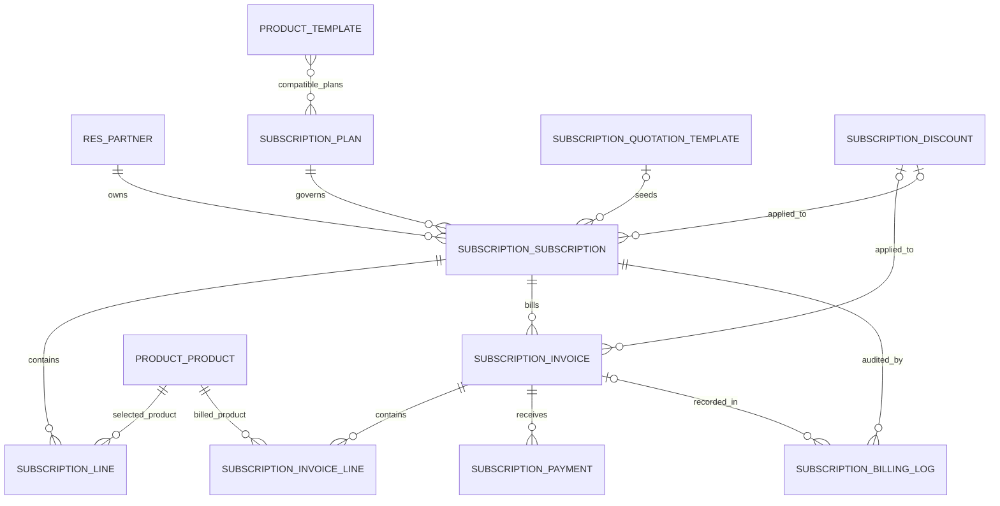

# Database Design

## Scope and persistence

Odoo's ORM maps the addon's models onto PostgreSQL tables and standard Odoo relation tables. This document lists the principal business entities and relationships declared in the Python models; it is not a DDL dump. The source of truth is `subscription_management/models/`.

## Entity relationship diagram

`RES_PARTNER`, `PRODUCT_TEMPLATE`, `PRODUCT_PRODUCT`, `RES_COMPANY`, `RES_CURRENCY`, `RES_USERS`, and `ACCOUNT_TAX` are standard Odoo models extended or referenced by the addon.

## Principal models

| Odoo model | Purpose | Important declared fields and relationships |
|---|---|---|
| `product.template` (extension) | Subscription product catalog. | `is_subscription`, `brand_name`, `brand_surcharge`, compatible `subscription_plan_ids`, computed `subscription_price`. `product.product` also exposes brand/surcharge/price fields. |
| `subscription.plan` | Billing terms and policy. | `name`, unique `code`, `active`, `price`, `currency_id`, `billing_interval_unit`, `billing_interval_count`, `min_quantity`, `start_date`, `end_date`, `auto_close`, `auto_close_days`, `allow_early_close`, `allow_pause`, `allow_renewal`, `description`. |
| `subscription.quotation.template` | Reusable quotation defaults. | Name, optional default plan, validity and one-to-many template lines. |
| `subscription.quotation.template.line` | Reusable quotation product row. | Template, product, quantity, unit price and related terms. |
| `subscription.subscription` | Quotation and subscription contract record. | Unique `name`; required `partner_id` and `plan_id`; optional `template_id`; state; start/expiry/quotation-validity dates; next/last billing dates; pause/close metadata; lines and invoices; company/currency/user; computed untaxed/tax/discount/total, MRR and ARR. |
| `subscription.line` | Product row on a contract. | Required `subscription_id`, product, description/name, quantity, unit price, taxes, discount, subtotal/tax/total and currency. |
| `subscription.invoice` | Billing document for a subscription period. | Required subscription, partner, invoice date, billing period start/end; due date; invoice and payment states; linked payments, discount and invoice lines; totals, paid amount and residual. SQL constraint prevents duplicate subscription-period invoices. |
| `subscription.invoice.line` | Product/tax/discount row on an invoice. | Required invoice, product, description/name, quantity, unit price, taxes, discount and computed subtotal/tax/total. |
| `subscription.payment` | Payment/settlement transaction record. | Required invoice, related partner/currency, payment date, amount, payment method, transaction state, reference and gateway-response text. |
| `subscription.discount` | Coupon/discount policy. | Name, code, type/value, validity window, purchase/quantity thresholds, usage limit/count, applicable products, currency, availability flags. |
| `subscription.billing.log` | Billing engine audit event. | Execution date, optional subscription/invoice, status, period dates, amount/currency, message and error traceback. |
| `subscription.dashboard` | Dashboard query/service model. | Provides database-backed KPI and analysis operations; access is guarded for internal subscription roles. |
| `subscription.dashboard.console` | Dashboard filter and presentation record. | Date range, partner, subscription/invoice status, billing frequency, payment method and calculated KPI/relation fields. |
| `subscription.customer.register.wizard` | Internal portal customer onboarding wizard. | Customer name/email, organization and password-confirmation inputs; transient UI workflow. |
| `subscription.payment.register.wizard` | Payment entry wizard. | Invoice, partner, amount, method, payment reference and note inputs. |

The model files also extend `subscription.subscription` and `subscription.invoice` with discount/payment integration fields and methods.

## Lifecycle and status fields

Subscription states declared in code are `draft`, `quotation`, `confirmed`, `active`, `paused`, `closed`, and `expired`. Invoice document states are `draft`, `confirmed`, `paid`, and `cancel`. Invoice payment states are `not_paid`, `partial`, and `paid`. Payment transaction states are `draft`, `success`, and `failed`.

Do not conflate an invoice document state with payment state. The native test run previously recorded an inconsistency between test expectations for expiry (`closed` versus `expired`); see [TESTING_REPORT.md](TESTING_REPORT.md).

## Integrity and monetary calculation

- Plan codes and subscription references have unique constraints.
- Invoice uniqueness is defined over `(subscription_id, billing_period_start, billing_period_end)`.
- Subscription/product lines reference products and taxes; invoices reference their source subscription and customer.
- Monetary fields use Odoo `Monetary`/currency fields where declared; product/plan pricing also uses float fields with Odoo price precision.
- Invoice amount paid, residual, and payment status are computed from linked payment transactions. A pending/unpaid invoice is not treated as collected revenue.

## Security relations

Portal rules use the current user's partner and commercial-partner hierarchy for subscriptions and invoices. Payment/invoice access also relies on module ACLs and related ownership logic. Exact access rules are defined in `security/security.xml`, `security/user_security.xml`, and `security/ir.model.access.csv`.

## Sources

- `subscription_management/models/product.py`
- `subscription_management/models/subscription_plan.py`
- `subscription_management/models/subscription.py`
- `subscription_management/models/subscription_invoice.py`
- `subscription_management/models/payment_hook.py`
- `subscription_management/models/payment.py`
- `subscription_management/models/discount_hook.py`
- `subscription_management/models/discount.py`
- `subscription_management/models/billing_log.py`
- `subscription_management/models/dashboard.py`
- `subscription_management/models/user_management.py`
