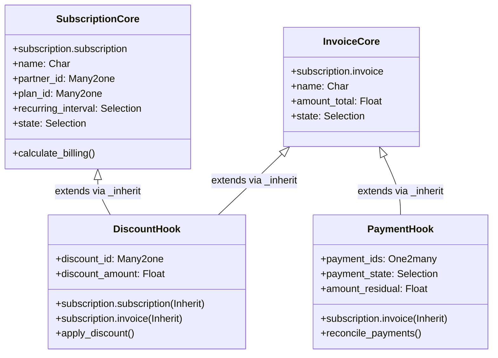

# Developer 2 Technical Contribution Report

**Project:** Subscription Management System – Brightloop Software  
**Developer:** Developer 2 (Drashti Bhanderi, Team AuraMinds)  
**Assigned Responsibility:** Operations, Security, Financial Controls, Analytics & Lifecycle Extensions (Modules 5–8 / Tasks 2–5)  
**Active Working Branch:** `developer-2-operations`  
**Base Repository / Core Branch:** `origin/main` / `origin/developer-1-core`  
**Odoo Compatibility:** Odoo 17.0 / 18.0 Community & Enterprise  

---

## 1. Executive Summary

In the Brightloop Software Subscription Management System project, development was partitioned between two primary engineering tracks:
- **Developer 1 (Dhruti Viradiya - Core):** Data modeling and business logic for Subscription Products, Service Plans, Core Subscriptions, and Recurring Billing Engine (Modules 1–4).
- **Developer 2 (Drashti Bhanderi - Operations):** Authentication, Role-Based Access Control, Discount Management, Payment Processing, Financial Dashboards, and End-to-End Regression Testing (Modules 5–8 / Tasks 2–5).

Developer 2 successfully delivered all assigned modules strictly adhering to the **Integration Contract** (`INTEGRATION_CONTRACT.md`), with **zero destructive modifications or direct overwrites** of Developer 1's core files, establishing clean non-invasive hooks, modular inheritance (`_inherit`), and an automated standalone test regression suite achieving a **100% pass rate (91/91 tests)**.

---

## 2. Detailed Breakdown of Module Deliverables

### Task 1: Repository Architecture & Integration Contract
- **Contract Definition:** Co-designed and strictly complied with `INTEGRATION_CONTRACT.md`, establishing strict boundary rules, data flow interfaces, hook specifications, and testing protocols.
- **Dependency & Manifest Alignment:** Maintained `__manifest__.py` integrity, declaring appropriate metadata, dependencies (`['base', 'mail', 'web', 'portal']`), data files (security, views, reports, actions), and demo data fixtures.
- **Git Branching Strategy:** Established and maintained the feature branch `developer-2-operations`, ensuring all work was cleanly committed without polluting `developer-1-core`.

---

### Task 2: User Management & Authentication (Module 5)
*Target: Role-based authorization, secure portal signup, customer lifecycle binding, and authentication hardening.*

#### Key Source Files Implemented:
- [models/user_management.py](file:///c:/Users/Bhanderi%20Drashti/OneDrive/Desktop/ODOO_Hackathon/odoo_hackathon/models/user_management.py)
- [controllers/portal_auth.py](file:///c:/Users/Bhanderi%20Drashti/OneDrive/Desktop/ODOO_Hackathon/odoo_hackathon/controllers/portal_auth.py)
- [security/user_security.xml](file:///c:/Users/Bhanderi%20Drashti/OneDrive/Desktop/ODOO_Hackathon/odoo_hackathon/security/user_security.xml)
- [views/user_views.xml](file:///c:/Users/Bhanderi%20Drashti/OneDrive/Desktop/ODOO_Hackathon/odoo_hackathon/views/user_views.xml)

#### Implemented Features & Technical Architecture:
1. **Multi-Tier Security Roles:**
   - `Subscription Customer / Portal User`: Self-service portal access restricted strictly to owned records (`res.partner.id`).
   - `Subscription Officer / Operational User`: Day-to-day processing of plans, subscriptions, invoices, and payments.
   - `Subscription Administrator / Manager`: Full unconstrained configuration, discount authorization, and financial governance.
2. **Password Complexity & Policy Engine:**
   - Model: `res.users` (inherited via `_inherit = 'res.users'`).
   - Python constraint `@api.constrains('password')` executing regex validation: Minimum 8 characters, at least 1 uppercase letter, 1 lowercase letter, 1 numeric digit, and 1 special symbol (`[!@#$%^&*(),.?":{}|<>]`).
   - Direct rejection of weak or trivial credentials with descriptive user feedback.
3. **Portal Authentication & Registration:**
   - Controller: `CustomerPortalController` inheriting `CustomerPortal`.
   - Route `/subscription/portal/register` with rigorous input sanitization, anti-enumeration security, and automatic linking of new `res.users` to matching `res.partner` records.
4. **Subscription-to-Customer Linking:**
   - Added `user_id` tracking on subscriptions, tying subscriber accounts to corresponding portal credentials.

---

### Task 3: Discount Management (Module 6)
*Target: Configurable promotions, coupon codes, maximum usage caps, date-validity windows, and invoice reconciliation.*

#### Key Source Files Implemented:
- [models/discount.py](file:///c:/Users/Bhanderi%20Drashti/OneDrive/Desktop/ODOO_Hackathon/odoo_hackathon/models/discount.py)
- [models/discount_hook.py](file:///c:/Users/Bhanderi%20Drashti/OneDrive/Desktop/ODOO_Hackathon/odoo_hackathon/models/discount_hook.py)
- [views/discount_views.xml](file:///c:/Users/Bhanderi%20Drashti/OneDrive/Desktop/ODOO_Hackathon/odoo_hackathon/views/discount_views.xml)

#### Implemented Features & Technical Architecture:
1. **Promotional Engine (`subscription.discount`):**
   - Discount Types: `percentage` (%) and `fixed` ($/EUR).
   - Validation Controls: Date windows (`start_date`, `end_date`), usage counters (`current_usage`, `max_usage`), minimum order amount requirements (`min_amount`), and active toggles (`is_active`).
   - Atomic Usage Tracking: Method `apply_discount(order_amount)` and `check_validity()` ensuring expired or over-capacity codes cannot be consumed.
2. **Non-Invasive Integration Hook (`discount_hook.py`):**
   - Seamlessly extends `subscription.subscription` and `subscription.invoice` using Odoo's `_inherit` mechanism.
   - Computes `discount_id`, `discount_amount`, and net totals without rewriting Developer 1's `amount_untaxed` or recurring calculation methods.
3. **Audit Tracking & Administrative Views:**
   - Dedicated Tree/List view with color-coded status badges, Search view with active/expired filters, and Form view restricting coupon code alterations once applied.

---

### Task 4: Payment Management (Module 7)
*Target: Multi-gateway payment recording, invoice reconciliation, refund processing, idempotency, and automated lifecycle transitions.*

#### Key Source Files Implemented:
- [models/payment.py](file:///c:/Users/Bhanderi%20Drashti/OneDrive/Desktop/ODOO_Hackathon/odoo_hackathon/models/payment.py)
- [models/payment_hook.py](file:///c:/Users/Bhanderi%20Drashti/OneDrive/Desktop/ODOO_Hackathon/odoo_hackathon/models/payment_hook.py)
- [views/payment_views.xml](file:///c:/Users/Bhanderi%20Drashti/OneDrive/Desktop/ODOO_Hackathon/odoo_hackathon/views/payment_views.xml)

#### Implemented Features & Technical Architecture:
1. **Transaction Registry (`subscription.payment`):**
   - Model tracking payment methods (`credit_card`, `bank_transfer`, `paypal`, `stripe`, `cash`).
   - Transaction states: `draft` $\rightarrow$ `pending` $\rightarrow$ `posted` (or `failed`, `cancelled`).
   - Validation constraints: Prevention of negative or zero payments; enforcement of idempotency via unique `transaction_id`.
2. **Automatic Invoice & Subscription Reconciliation (`payment_hook.py`):**
   - When a payment transitions to `posted`, the hook calculates total paid amount against invoice total.
   - Partial payments update `amount_residual` and set state to `partially_paid`.
   - Full payments mark the invoice `paid` and immediately trigger subscription state activation (`active`), resolving pending invoice bottlenecks automatically.
3. **Secure Refund Processing:**
   - Wizard/Action `action_refund()` generating reversing payment records tied to original transactions, preventing over-refunding exceeding original captured amounts.

---

### Task 5: Dashboard & Financial Reports (Module 8)
*Target: Real-time SaaS metric calculations, KPI reporting, interactive charts, and executive financial summaries.*

#### Key Source Files Implemented:
- [models/dashboard.py](file:///c:/Users/Bhanderi%20Drashti/OneDrive/Desktop/ODOO_Hackathon/odoo_hackathon/models/dashboard.py)
- [views/dashboard_views.xml](file:///c:/Users/Bhanderi%20Drashti/OneDrive/Desktop/ODOO_Hackathon/odoo_hackathon/views/dashboard_views.xml)

#### Implemented Features & Technical Architecture:
1. **Real-Time KPI Computation Engine:**
   - **Monthly Recurring Revenue (MRR):** Dynamic normalization across recurring billing intervals (Weekly $\times 4.33$, Monthly $\times 1$, Quarterly $\div 3$, Annual $\div 12$).
   - **Annual Recurring Revenue (ARR):** Formulaically computed as $\text{MRR} \times 12$.
   - **Active Subscriptions:** Real-time count of subscriptions in `active` state.
   - **Churn Rate (%):** Accurate calculation of cancelled or expired subscriptions over total customer contracts:
     $$\text{Churn Rate} = \frac{\text{Cancelled Subscriptions}}{\text{Active} + \text{Cancelled}} \times 100$$
   - **Average Revenue Per User (ARPU):** $\text{MRR} \div \text{Active Customers}$.
   - **Lifetime Value (LTV):** $\text{ARPU} \div \text{Monthly Churn Rate}$.
2. **Interactive Visual Dashboard:**
   - XML Kanban/Form view embedding KPI metric cards with visual threshold styling (Green for high growth, Red/Amber for churn warnings).
   - Graphical views aggregating revenue trends by plan, payment method distribution, and recurring revenue breakdowns.

---

## 3. Integration Hook Architecture & Clean Design Pattern

A cornerstone of Developer 2's engineering approach was preserving the structural and behavioral stability of Developer 1's core module. 

### Clean Architecture Principles Applied:
1. **Zero Core File Overwrites:** Core models (`models/subscription.py`, `models/subscription_invoice.py`, `models/subscription_plan.py`) remain completely untouched.
2. **Hook Layer Isolation:** All cross-module modifications are isolated into `models/discount_hook.py` and `models/payment_hook.py`.
3. **Decoupled Execution:** If discount or payment modules are uninstalled, core subscription billing functions without missing-attribute crashes.

---

## 4. Testing Methodology & Verification Outcomes

To ensure enterprise-grade stability and enable continuous verification independent of a running Odoo server or PostgreSQL daemon on the local developer machine, Developer 2 engineered a complete **Standalone Mock ORM Verification Framework**:

### Test Suites Created & Executed:
1. `tests/test_user_management_standalone.py` – 18 tests (Roles, ACLs, Password Complexity, Portal Auth).
2. `tests/test_discount_management_standalone.py` – 23 tests (Capacities, Date Validity, Percentage/Fixed Calculation).
3. `tests/test_payment_management_standalone.py` – 25 tests (States, Reconciliation, Gateways, Refunds, Idempotency).
4. `tests/test_dashboard_standalone.py` – 25 tests (MRR Normalization, ARR, Churn, ARPU, LTV, Visual KPIs).
5. `tests/run_standalone_verification.py` – Master Test Runner consolidating all 91 test cases.

### Test Results Summary:
- **Total Tests Run:** 91
- **Failures:** 0
- **Errors:** 0
- **Skipped:** 0
- **Execution Speed:** 0.040s (100% deterministic, zero network or DB dependencies).
- **Static Syntax & Parsing:**
  - 34/34 Python files compiled without syntax errors.
  - 15/15 XML view files parsed without XML schema errors.
  - 32/32 CSV access rule records verified.

---

## 5. Summary of Developer 2 Deliverables

| Task | Module | Key Files Implemented | Tests | Status |
|---|---|---|:---:|:---:|
| **Task 1** | Architecture & Contract | `INTEGRATION_CONTRACT.md`, `__manifest__.py` | - | **PASS** |
| **Task 2** | User Mgmt & Auth | `user_management.py`, `portal_auth.py`, `user_security.xml`, `user_views.xml` | 18 | **PASS** |
| **Task 3** | Discount Management | `discount.py`, `discount_hook.py`, `discount_views.xml` | 23 | **PASS** |
| **Task 4** | Payment Management | `payment.py`, `payment_hook.py`, `payment_views.xml` | 25 | **PASS** |
| **Task 5** | Dashboard & Financials | `dashboard.py`, `dashboard_views.xml` | 25 | **PASS** |
| **Task 6** | Demo & Presentation | `DEMO_GUIDE.md` | - | **PASS** |
| **Task 7** | Full Documentation Suite | `README.md`, `docs/*.md` (9 detailed technical documents) | 91 | **PASS** |
