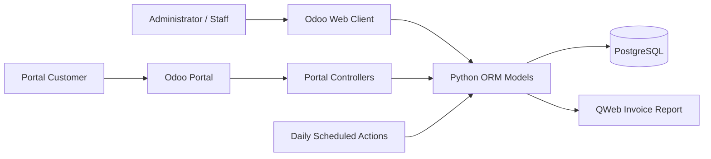
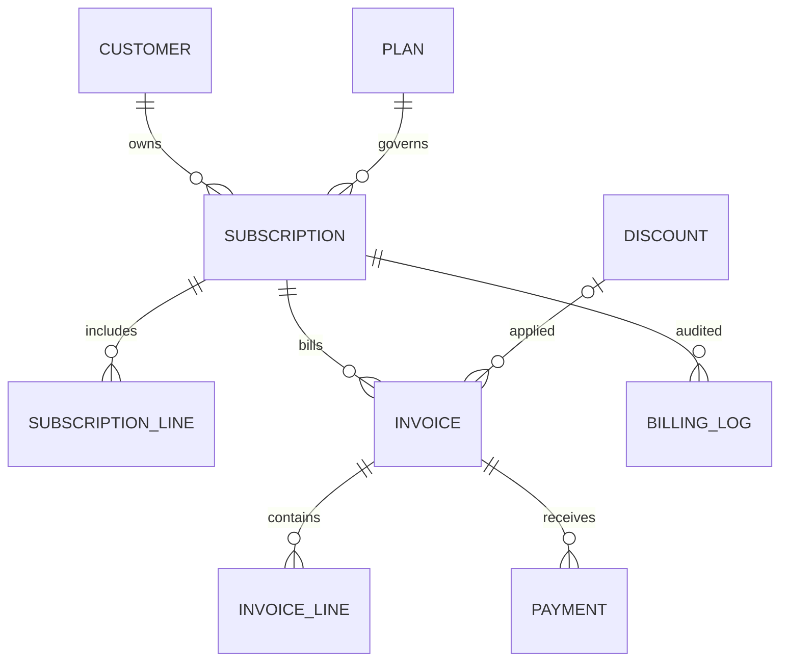

# Hackathon Presentation Content

Slide-ready material for Brightloop Software — Subscription Management System (Odoo 17).

## Slide 1 — Title

**Brightloop Subscription Management**  
Subscription lifecycle and recurring billing inside Odoo 17  
Team AuraMinds

## Slide 2 — Problem

- Subscription operations span product catalog, recurring plans, quotations, active contracts, invoices, payments, and customer support.
- Manual billing and scattered records make it harder to track renewal dates, outstanding invoices, and contract status.
- Customers need access to their own subscription and invoice information without access to internal company reports.

These are the project problem themes reflected in the repository's guides and implementation; a standalone original hackathon prompt was not found in the repository.

## Slide 3 — Proposed solution and objectives

- Put subscription contracts and recurring billing workflows into an Odoo addon.
- Link customer, plan, product lines, billing periods, invoices, and payment transactions.
- Automate scheduled billing and record billing attempts in an audit model.
- Provide role-based internal views and customer-specific portal pages.
- Surface database-backed operational and financial indicators in an internal dashboard.

## Slide 4 — Users and roles

| Role | Intended use |
|---|---|
| Subscription Administrator | Plan/pricing configuration, access administration, scheduled-action oversight, and internal reporting. |
| Officer / Staff | Customer quotations, subscription operations, invoice and payment records. |
| Portal Customer | View own subscriptions, quotations, available plans, invoices and billing history. |

Portal users must not be granted internal dashboard roles.

## Slide 5 — Key implemented features

- Product subscription eligibility, variant/brand pricing fields.
- Configurable recurring plan interval and policy.
- Quotation and subscription contract lifecycle.
- Recurring invoices linked to subscription billing periods.
- Duplicate invoice-period database constraint and billing logs.
- Discount and payment transaction models integrated with invoice totals/status.
- Internal dashboard and Odoo search/graph/pivot views.
- Customer-scoped portal pages and invoice report route.

## Slide 6 — Architecture

Stack: Odoo 17, Python/Odoo ORM, PostgreSQL, XML views/templates, Odoo web client and portal, Docker Compose. The addon declares CSS for portal styling; it does not declare a custom JavaScript asset bundle.

## Slide 7 — Data model

Primary addon entities: `subscription.plan`, `subscription.subscription`, `subscription.line`, `subscription.invoice`, `subscription.invoice.line`, `subscription.payment`, `subscription.discount`, and `subscription.billing.log`.

## Slide 8 — Main workflow

1. Set up a subscription product and plan.
2. Create a customer quotation and add products.
3. Confirm and activate the subscription.
4. Track the next billing date and contract status.
5. Generate a linked invoice for the billing period.
6. Register/record a payment transaction and inspect invoice residual.
7. Customer signs in to portal to review its own data.

The demo loader creates synthetic quotations, a subscription, and an unpaid invoice. It does not create fake payment success.

## Slide 9 — Security and trust

- Module roles separate administrator, internal staff, and portal customer access.
- Portal controller searches include the authenticated partner scope.
- Subscription/invoice portal rules restrict records by partner/commercial partner.
- Dashboard is an internal feature.
- Invoice and payment status are distinct; an unpaid invoice is not counted as a settled payment.

## Slide 10 — Demo evidence

The local admin dashboard screenshot is available at [screenshots/admin-dashboard.png](screenshots/admin-dashboard.png) when captured in the current submission. It is a live dashboard snapshot, not a mockup.

Additional product/plan, quotation, invoice, payment, and customer portal screenshots were not captured for this submission. Do not present them as verified visual evidence without performing a fresh authenticated walkthrough.

## Slide 11 — Testing and current limitations

- Standalone regression verification: 92 tests passed.
- All 16 addon XML files parsed successfully.
- Native Odoo suite on populated local DB: 14 failures and 6 errors in 132 tests; not a clean isolated run.
- Portal, PDF output, cron side effects, and provider transactions not verified for this submission.
- Invoice “send email” method posts chatter text rather than sending mail.
- Contract-listed financial report XML is absent.

Refer to [TESTING_REPORT.md](TESTING_REPORT.md) for evidence qualifications.

## Slide 12 — Practical value and future scope

**Practical value**

- Keeps contract and billing-period information connected to customer and product records.
- Reduces manual recurring-invoice work when scheduled billing is configured and verified.
- Gives internal staff a shared operational view and customers a scoped self-service portal.

**Future work**

- Run and stabilize the native test suite against isolated databases.
- Verify and improve portal experience, invoice PDF delivery, and customer workflow.
- Implement/test actual email dispatch with templates and failure reporting.
- Integrate a real payment provider using sandbox credentials and end-to-end tests.
- Deliver a printable financial report if required by the submission rubric.
- Add repeatable CI and a clean-install/upgrade test.

## Presenter caution

Do not claim live gateway processing, actual invoice email delivery, a clean native test run, or portal/PDF visual verification unless new evidence is collected. Consult [FINAL_PROJECT_REPORT.md](FINAL_PROJECT_REPORT.md) before the presentation.
