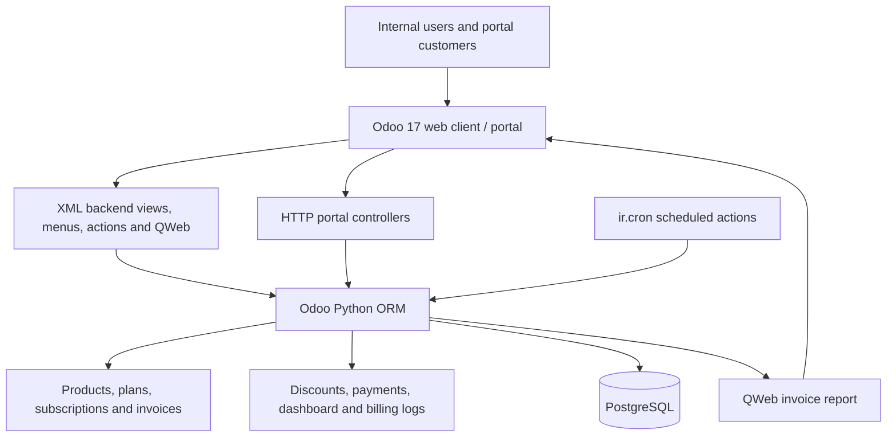

# Project Architecture

## Product context

Brightloop Subscription Management is an Odoo 17 addon that extends Odoo's standard ORM, web client, mail/activity mixins, portal framework, product catalog, and PostgreSQL persistence. The addon is registered as `subscription_management` by `subscription_management/__manifest__.py`.

The separate original hackathon problem statement was not found in the repository. This document describes the code currently present rather than treating every item in the integration contract as delivered.

## Runtime and layers



### Technology by layer

| Layer | Implementation |
|---|---|
| ERP/runtime | Odoo 17; Docker image tag defaults to `17.0` in Compose. |
| Application | Python models/controllers using the Odoo ORM and HTTP/portal APIs. |
| Persistence | PostgreSQL, provided by the Compose `db` service. Odoo creates the actual relational schema from model definitions. |
| Internal UI | Odoo web client with XML list, form, search, graph, pivot, menu, and action declarations. |
| Portal UI | Odoo portal templates in `views/portal_templates.xml`, controller routes, and `static/src/css/portal.css`. The manifest does not declare custom JavaScript assets. |
| Automation | Three daily `ir.cron` actions for recurring billing, expiry, and upcoming-billing notifications. Their records were enabled in the inspected local database; execution was not verified for this submission. |
| Reports | QWeb subscription-invoice report in `reports/invoice_report.xml`. The integration contract refers to `reports/financial_report.xml`, which is not present. |
| Local orchestration | `docker-compose.yml` maps Odoo 17 and PostgreSQL and bind-mounts the addon. |

## Addon module map

```text
subscription_management/
├── __manifest__.py
├── controllers/
│   ├── portal_auth.py
│   └── subscription_portal.py
├── data/
│   ├── cron_data.xml
│   └── sequence_data.xml
├── models/
│   ├── product.py
│   ├── subscription_plan.py
│   ├── subscription.py
│   ├── subscription_invoice.py
│   ├── billing_log.py
│   ├── discount.py
│   ├── payment.py
│   ├── dashboard.py
│   └── user_management.py
├── reports/
│   └── invoice_report.xml
├── scripts/
│   └── load_demo_data.py
├── security/
│   ├── ir.model.access.csv
│   ├── security.xml
│   └── user_security.xml
├── static/src/css/portal.css
├── tests/
└── views/
    ├── product_views.xml
    ├── subscription_plan_views.xml
    ├── subscription_views.xml
    ├── invoice_views.xml
    ├── billing_log_views.xml
    ├── discount_views.xml
    ├── payment_views.xml
    ├── dashboard_views.xml
    ├── user_views.xml
    ├── menu_views.xml
    └── portal_templates.xml
```

The addon structure above comes from the current repository. Some files extend model definitions: `discount.py` extends subscription/invoice behavior and `payment.py` extends invoice/payment behavior, while hook files define the base extension models loaded by the module.

## Main runtime flow

1. An internal user creates a subscription-eligible product and a plan.
2. A quotation record is created on `subscription.subscription` with customer, plan, product lines, terms, and quotation state.
3. Confirmation/activation actions progress the record through its lifecycle.
4. Active subscriptions expose a next billing date. The daily recurring-billing job creates a linked `subscription.invoice` for the billing period. The invoice model has a unique constraint on subscription and billing-period dates.
5. Payment transaction records link to invoices. Invoice payment totals and residuals are calculated from payment records.
6. Internal users use the dashboard, lists, and analysis views. Portal users use authenticated HTTP routes and partner-scoped searches for their own records.

## Security design

The module defines Subscription Administrator, Officer / Staff, and Portal Customer groups in `security/security.xml`. ACLs are in `security/ir.model.access.csv`; record rules restrict portal users to their own partner/commercial-partner records for subscriptions and invoices. Portal routes additionally filter by the logged-in user's partner before serving subscription/invoice detail and PDF routes.

Portal customers are not granted internal dashboard access. This documentation does not recommend relaxing ACLs or rules to simplify a demo.

## Important implementation boundaries

- The payment model stores transaction method, amount, reference, status, and a gateway-response text field. The presence of Stripe/PayPal method labels does not itself prove a live provider integration.
- `subscription.invoice.action_send_email()` currently posts a chatter message stating the invoice was sent; the reviewed method does not dispatch an email.
- Portal subscription cancellation and renewal requests are requests for staff review, not direct status changes.
- The QWeb invoice PDF route/report exists, but an actual PDF download was not verified for this submission.
- The module manifest has no demo XML data; the reproducible local sample loader is a separate Python script.
