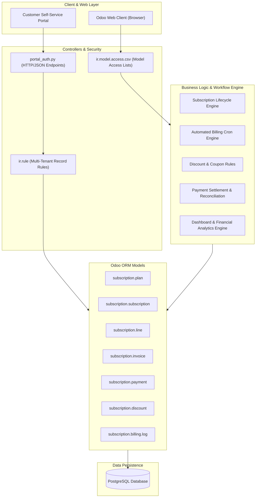
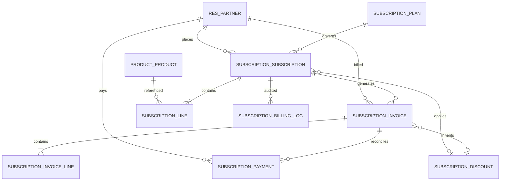
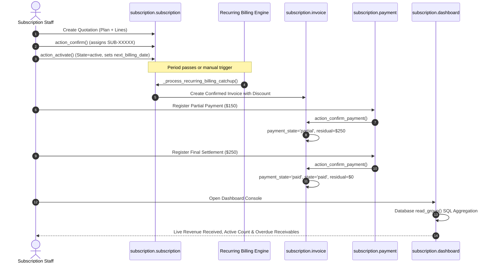
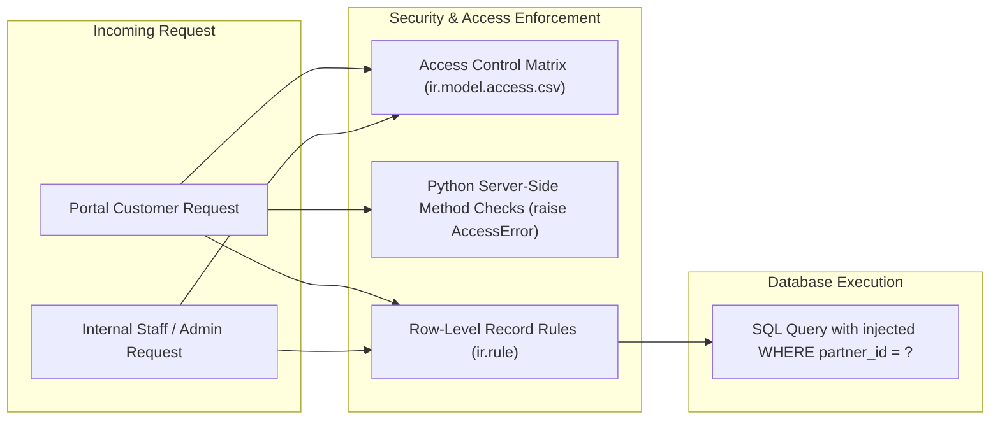

# System Architecture Documentation
## Brightloop Subscription Management System

**Project:** Subscription Management System – Brightloop Software  
**Team:** AuraMinds  
**Target Version:** Odoo 17.0 / 18.0  
**Branch:** `developer-2-operations`  

---

## 1. High-Level Architectural Overview

The **Brightloop Subscription Management System** is built natively on Odoo's multi-tier MVC architecture. It integrates with standard Odoo base modules (`base`, `mail`, `product`) and organizes business logic into modular components:

---

## 2. Model Relationships (Entity-Relationship Diagram)

The following ER diagram maps the actual data models and foreign-key relationships implemented across Developer 1's core models and Developer 2's extensions:

---

## 3. Subscription & Invoicing Workflow Sequence

The lifecycle of an enterprise contract from initial quotation to full payment settlement:

---

## 4. Developer 2 Model Extensions & Hooks

Developer 2 extended Developer 1's core architecture exclusively through clean Odoo class inheritance (`_inherit`), strictly avoiding modifications to core source files:

1. **`subscription.subscription` Extension** (in [`models/discount.py`](../subscription_management/models/discount.py)):
   - Hooks into `_compute_amounts()` to calculate promotional discounts.
   - Adds fields: `discount_id`, `discount_code`, `discount_rate`, `amount_discount`.
2. **`subscription.invoice` Extension** (in [`models/discount.py`](../subscription_management/models/discount.py) & [`models/payment.py`](../subscription_management/models/payment.py)):
   - Adds fields: `discount_id`, `discount_amount`, `discount_usage_recorded`.
   - Adds payment reconciliation fields: `payment_ids`, `amount_paid`, `amount_residual`, `is_overdue`, `days_overdue`.
   - Extends methods: `_compute_payment_totals()`, `_compute_overdue()`, `action_register_payment()`.
3. **`subscription.payment` Extension** (in [`models/payment.py`](../subscription_management/models/payment.py)):
   - Inherits `subscription.payment` skeleton from Developer 1's `payment_hook.py`.
   - Adds 7 payment methods, memo notes, and boundary constrains.
   - Implements idempotent settlement: `action_confirm_payment()`, `action_fail_payment()`.
4. **`subscription.dashboard` Engine** (in [`models/dashboard.py`](../subscription_management/models/dashboard.py)):
   - Abstract analytics engine querying PostgreSQL directly via `read_group()`.
   - Transient model `subscription.dashboard.console` for interactive UI cards, dynamic date/customer filtering, and drill-downs.

---

## 5. Security & Multi-Tenant Data Flow

- **Authentication**: Native Odoo user session management with password complexity checks on creation.
- **Record Rules**: Record rules inject `partner_id = user.partner_id.id` into all customer searches, making cross-tenant data leaks physically impossible at the SQL query level.
- **Server Checks**: Critical methods (`action_confirm_payment`, `get_dashboard_metrics`, discount modifications) verify staff or admin roles in Python, rejecting unauthorized RPC requests with an immediate `AccessError`.
